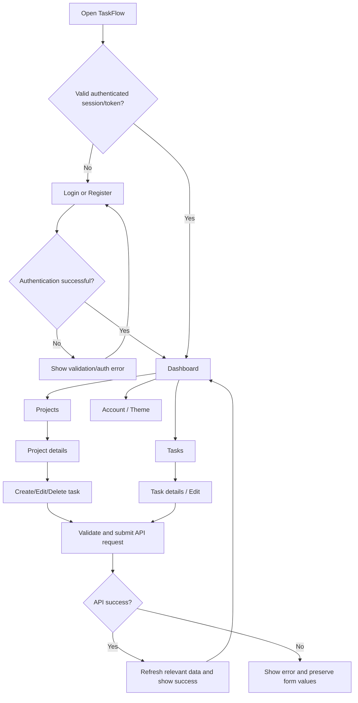

# TaskFlow — Application Flow (AppFlow)

## 1. Main application flow

## 2. Registration flow

1. Visitor opens Register.
2. Enters username, email, password, and any required confirmation field.
3. React validates required fields and basic formatting.
4. Frontend submits to `POST /api/v1/auth/register/`.
5. Django validates uniqueness and password rules, then creates the user.
6. UI displays success or field-specific errors.
7. User proceeds to login, unless registration is explicitly designed to sign the user in.

## 3. JWT login and refresh flow

1. User submits credentials on Login.
2. Frontend sends credentials to `POST /api/v1/auth/token/`.
3. Backend validates credentials and returns JWT tokens.
4. Frontend establishes authentication according to the chosen storage strategy.
5. Protected API requests include the access token in the configured way.
6. If an access token expires, the client attempts one refresh request to `POST /api/v1/auth/token/refresh/`.
7. If refresh succeeds, retry the original request once.
8. If refresh fails, clear authentication state and redirect to Login.
9. Logout clears client authentication state and calls the backend logout endpoint; if refresh-token blacklisting is enabled, the backend invalidates the submitted refresh token.

Avoid infinite refresh loops. Do not retry a failed refresh request as if it were an ordinary protected API request.

## 4. Project creation flow

1. User opens Projects.
2. Selects Create Project.
3. Enters a required name and optional description.
4. React validates required fields.
5. Sends `POST /api/v1/projects/`.
6. Backend assigns `owner=request.user` and validates input.
7. On success, project list refreshes and success feedback appears.
8. On failure, preserve form input and display the error.

## 5. Task creation flow

1. User chooses a project and selects Add Task.
2. Enters title, description, status, priority, and optional due date.
3. React validates required fields.
4. Sends `POST /api/v1/tasks/` with the selected project ID.
5. Backend confirms the project belongs to the authenticated user.
6. Backend validates and saves the task.
7. Task list and dashboard summary refresh.
8. If the project is not owned by the user, the API rejects the request without exposing another user's data.

## 6. Task update flow

1. User opens a task and selects Edit or changes status.
2. Form loads existing values.
3. User makes changes and submits.
4. Frontend sends a PATCH request.
5. Backend checks authentication, ownership, and field validity.
6. Updated task is returned.
7. UI updates the task and any affected counts.

## 7. Deletion flow

1. User selects Delete.
2. Confirmation dialog appears.
3. User cancels or confirms.
4. If confirmed, frontend sends DELETE.
5. Backend checks ownership and deletes the record.
6. UI refreshes the list and dashboard.
7. Project deletion warns that associated tasks will also be deleted.

## 8. Dashboard flow

1. On dashboard load, React requests the summary and upcoming tasks.
2. Show loading placeholders while requests are pending.
3. Backend calculates counts only from the current user's records.
4. Render summary cards, recent tasks, upcoming deadlines, and project progress.
5. If there is no data, show onboarding actions.
6. If a request fails, show a retry option.

## 9. Search and filtering flow

1. User types a search term or selects filters.
2. React builds query parameters such as `search`, `status`, `priority`, and `project`.
3. Django filters only the current user's tasks.
4. API returns matching records.
5. React updates the list and displays an empty-results message if needed.

## 10. Theme flow

1. On app startup, read saved theme preference.
2. If an explicit preference exists, apply it.
3. Otherwise use the default light theme; optionally respect system preference only until the user makes a choice.
4. User toggles the theme.
5. Update the theme attribute and CSS variables immediately.
6. Save the preference in localStorage.
7. Apply the same theme across authenticated and public pages.

## 11. Exceptional states

| Condition | Expected result |
|---|---|
| Invalid credentials | Show generic authentication error |
| Access token expired | Attempt one refresh |
| Refresh token expired/revoked | Clear auth and redirect to login |
| Network failure | Show retry action |
| Invalid form | Keep values and show field errors |
| Task not found | Show not-found state |
| User tries another user's project | Reject request without data disclosure |
| Empty dashboard | Show create-project/task action |
| No filter matches | Show no-results state |
| Save fails | Do not show success; preserve user input |
