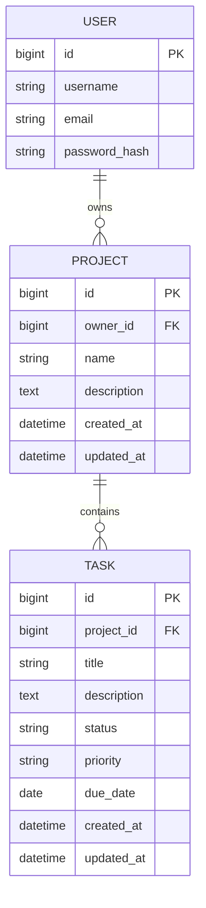

# TaskFlow — Backend Schema

## 1. Overview

The MVP uses Django's configured user model and two main application models: `Project` and `Task`. A task belongs to a project; project ownership determines which user may access the task.

## 2. Entity relationship diagram



The user entity is Django's built-in or configured user model; do not create a second user table unnecessarily.

## 3. Project model

| Field | Django type | Rules |
|---|---|---|
| `id` | `BigAutoField` | Primary key |
| `owner` | `ForeignKey(settings.AUTH_USER_MODEL)` | Required; cascade on user deletion |
| `name` | `CharField(max_length=120)` | Required |
| `description` | `TextField` | Blank allowed |
| `created_at` | `DateTimeField(auto_now_add=True)` | Set automatically |
| `updated_at` | `DateTimeField(auto_now=True)` | Updated automatically |

## 4. Task model

| Field | Django type | Rules |
|---|---|---|
| `id` | `BigAutoField` | Primary key |
| `project` | `ForeignKey(Project)` | Required; cascade on project deletion |
| `title` | `CharField(max_length=200)` | Required |
| `description` | `TextField` | Blank allowed |
| `status` | `CharField(choices=...)` | Defaults to `TODO` |
| `priority` | `CharField(choices=...)` | Defaults to `MEDIUM` |
| `due_date` | `DateField` | Null/blank allowed |
| `created_at` | `DateTimeField(auto_now_add=True)` | Set automatically |
| `updated_at` | `DateTimeField(auto_now=True)` | Updated automatically |

### Allowed values

Status:
- `TODO`
- `IN_PROGRESS`
- `COMPLETED`

Priority:
- `LOW`
- `MEDIUM`
- `HIGH`

## 5. Model implementation

```python
from django.conf import settings
from django.db import models


class Project(models.Model):
    owner = models.ForeignKey(
        settings.AUTH_USER_MODEL,
        on_delete=models.CASCADE,
        related_name="projects",
    )
    name = models.CharField(max_length=120)
    description = models.TextField(blank=True)
    created_at = models.DateTimeField(auto_now_add=True)
    updated_at = models.DateTimeField(auto_now=True)

    def __str__(self):
        return self.name


class Task(models.Model):
    class Status(models.TextChoices):
        TODO = "TODO", "To Do"
        IN_PROGRESS = "IN_PROGRESS", "In Progress"
        COMPLETED = "COMPLETED", "Completed"

    class Priority(models.TextChoices):
        LOW = "LOW", "Low"
        MEDIUM = "MEDIUM", "Medium"
        HIGH = "HIGH", "High"

    project = models.ForeignKey(
        Project,
        on_delete=models.CASCADE,
        related_name="tasks",
    )
    title = models.CharField(max_length=200)
    description = models.TextField(blank=True)
    status = models.CharField(
        max_length=20,
        choices=Status.choices,
        default=Status.TODO,
    )
    priority = models.CharField(
        max_length=10,
        choices=Priority.choices,
        default=Priority.MEDIUM,
    )
    due_date = models.DateField(null=True, blank=True)
    created_at = models.DateTimeField(auto_now_add=True)
    updated_at = models.DateTimeField(auto_now=True)

    def __str__(self):
        return self.title
```

Place models in the appropriate Django apps, register them in admin if useful, then create and apply migrations.

## 6. Ownership and authorization rules

- Project list and detail querysets must be restricted to `owner=request.user`.
- Task querysets must be restricted to `project__owner=request.user`.
- When creating a project, set owner from the authenticated request.
- When creating or updating a task, validate that its project belongs to the authenticated user.
- Do not accept owner IDs from the client as authoritative.
- Test read, update, and delete attempts across two different users.
- Returning 404 for inaccessible objects can avoid revealing whether another user's record exists.

Example queryset:

```python
Task.objects.filter(project__owner=request.user)
```

## 7. Serializer rules

### Project serializer
Expose ID, name, description, created/updated timestamps, and optionally a read-only task count. Set ownership server-side in the view or serializer's `create()` method.

### Task serializer
Expose ID, project ID, title, description, status, priority, due date, and timestamps. Validate project ownership before saving.

## 8. Dashboard calculations

Calculate statistics from the current user's projects/tasks:
- Total projects.
- Total tasks.
- Count by status.
- Overdue incomplete tasks.
- Upcoming incomplete tasks.

An overdue task has a due date before the current local date and is not completed. Use Django timezone utilities.

## 9. API routes

Authentication:
- `POST /api/v1/auth/register/`
- `POST /api/v1/auth/token/`
- `POST /api/v1/auth/token/refresh/`
- `POST /api/v1/auth/logout/`
- `GET /api/v1/auth/me/`

Projects:
- `GET/POST /api/v1/projects/`
- `GET/PATCH/DELETE /api/v1/projects/{id}/`

Tasks:
- `GET/POST /api/v1/tasks/`
- `GET/PATCH/DELETE /api/v1/tasks/{id}/`

Dashboard:
- `GET /api/v1/dashboard/summary/`
- `GET /api/v1/dashboard/upcoming-tasks/`

## 10. JWT configuration notes

Use `djangorestframework-simplejwt`; do not implement JWT cryptography manually. Define access and refresh lifetimes explicitly. Decide whether to rotate refresh tokens and enable the blacklist app. If blacklisting is enabled, add `rest_framework_simplejwt.token_blacklist` to installed apps and run migrations. Design token storage and refresh behavior deliberately; browser refresh tokens in HttpOnly, Secure cookies require correct CSRF handling.

## 11. Integrity and indexes

- Validate choices and required text fields.
- Keep task ownership derived through the project's owner to avoid duplicated ownership fields.
- Consider indexes on owner/creation date, project/status, due date, and frequently combined filters as data volume grows.
- Confirm cascade deletion behavior in tests.
